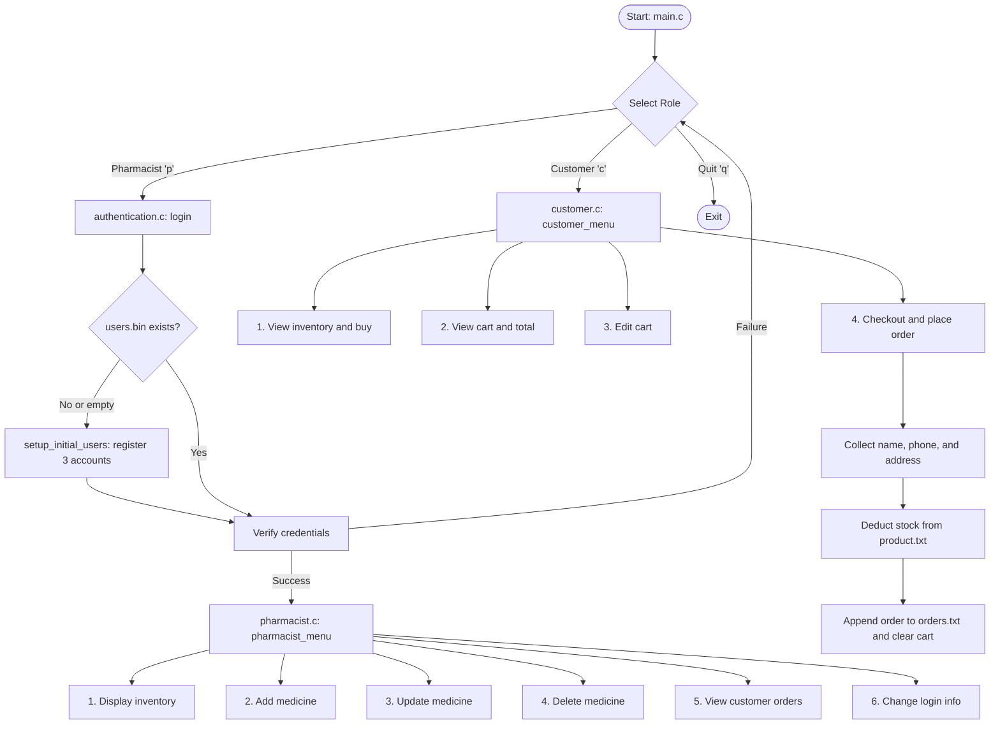

# Mini Pharmacy Management System


A modular, console-based Pharmacy Management System written in C for Windows. The application uses a multi-file architecture and binary file persistence. It provides two role-based portals:

- **Pharmacist Portal:** inventory management (create, read, update, delete), authentication, and customer order tracking.
- **Customer Portal:** inventory browsing, a shopping cart, and automatic stock deduction at checkout.

---

## Table of Contents

- [Features](#features)
- [Technology Stack](#technology-stack)
- [Project Structure](#project-structure)
- [Data Schema](#data-schema)
- [System Workflow](#system-workflow)
- [Build and Run](#build-and-run)
- [First-Time Usage](#first-time-usage)
- [Author](#author)

---

## Features

### Pharmacist Portal

- **First-run account setup:** If `users.bin` is missing or empty, the program prompts for up to three pharmacist accounts.
- **Masked authentication:** Passwords are entered with `getch()`, displayed as `*`, and can be corrected with Backspace.
- **Inventory management:**
  - **Display:** A formatted table of medicine ID, name, unit price, stock, and expiry date (`MM/YY`).
  - **Add:** Add multiple medicines in one session.
  - **Update:** Modify name, price, stock, or expiry date in place using `fseek()`.
  - **Delete:** Remove a medicine by swapping in a temporary file.
- **Order tracking:** View all customer orders, including contact details, delivery address, items, quantities, and totals.
- **Credential management:** Update the admin login or reset all three pharmacist accounts.

### Customer Portal

- **Inventory browsing:** View available medicines, prices, stock levels, and expiry dates.
- **Shopping cart (`cart.txt`):**
  - Add multiple medicines to the cart.
  - Stock validation prevents ordering more units than are available.
  - View itemized subtotals and the grand total.
- **Cart editor:** Add items, remove items by ID, or change quantities.
- **Checkout:**
  - Collects name, phone number, and delivery address.
  - Saves the order to `orders.txt`.
  - Deducts purchased quantities from `product.txt` and clears the cart.

---

## Technology Stack

> **Platform requirement:** This project uses Windows-specific headers (`<conio.h>` and `<windows.h>`) for password masking (`getch()`), console colors, and screen control (`Sleep()`, `system("cls")`). It must be compiled and run on Windows.

| Component | Version / Specification | Notes |
| :--- | :--- | :--- |
| Language | C (C99 / C11) | Multi-file compilation |
| IDE | Code::Blocks 25.03 | Project file: `PMS.cbp` |
| Compiler | MinGW GCC (MinGW-w64) | Any Windows GCC distribution should work |
| Standard libraries | `<stdio.h>`, `<stdlib.h>`, `<string.h>` | File I/O, memory, strings |
| System libraries | `<conio.h>`, `<windows.h>` | Console input and Windows API |

---

## Project Structure

The codebase has one shared header and four source files:

```text
Pharmacy-management-system/
├── pharmacy.h          # Structs and function prototypes
├── main.c              # Entry point, role selection, input helpers
├── authentication.c    # Login, password masking, account setup
├── pharmacist.c        # Inventory management and order history
├── customer.c          # Shopping cart, cart editor, checkout
├── PMS.cbp             # Code::Blocks project file
├── .gitignore          # Excludes build output and runtime data
└── README.md           # Project documentation
```

---

## Data Schema

Runtime files are created automatically. The program reads and writes C structs directly in binary mode (`rb`, `wb`, `ab`, `rb+`). The `.txt` extension on `product.txt`, `cart.txt`, and `orders.txt` is kept for compatibility with earlier versions; these files contain binary data, not text.

| File | C Struct | Fields | Purpose |
| :--- | :--- | :--- | :--- |
| `users.bin` | `struct account` | `username[20]`, `password[20]` | Pharmacist login credentials |
| `product.txt` | `struct product` | `id`, `stk`, `price`, `nam[25]`, `exp[12]` | Medicine inventory |
| `cart.txt` | `struct product` | `id`, `stk` (quantity), `price`, `nam[25]`, `exp[12]` | Active customer cart |
| `orders.txt` | `struct order_record` | `struct customer_info cust`, `struct product item` | Log of completed orders |

---

## System Workflow



---

## Build and Run

### Option 1: Code::Blocks (recommended)

1. Clone the repository:
   ```bash
   git clone https://github.com/INTE5HAR/Pharmacy-management-system.git
   ```
2. Open Code::Blocks and load `PMS.cbp`.
3. Press **F9** to build and run.

### Option 2: Command line (MinGW GCC)

1. Open Command Prompt or PowerShell in the project folder.
2. Compile the source files:
   ```bash
   gcc main.c authentication.c pharmacist.c customer.c -o pharmacy.exe
   ```
3. Run the program:
   ```bash
   pharmacy.exe
   ```

---

## First-Time Usage

> **Note:** Runtime data files (`users.bin`, `product.txt`, `orders.txt`, `cart.txt`) are excluded from version control, so the program starts with no data.

1. **Create pharmacist accounts:** Run the program and enter `p`. Since `users.bin` does not exist, you will be asked to create up to three accounts.
2. **Add inventory:** Log in and choose **Option 2** to add medicines with prices, quantities, and expiry dates.
3. **Test a customer purchase:** Choose **Option 7** to log out, then enter `c`. Browse inventory (**Option 1**), add items to the cart, optionally use the cart editor (**Option 3**), and check out (**Option 4**).
4. **Verify the results:** Log back in as a pharmacist. Check that stock was reduced (**Option 1**) and that the order appears under **Option 5**.

---

## Author

**Inteshar Alam**
- GitHub: [@INTE5HAR](https://github.com/INTE5HAR)
- Original build date: December 11, 2023
